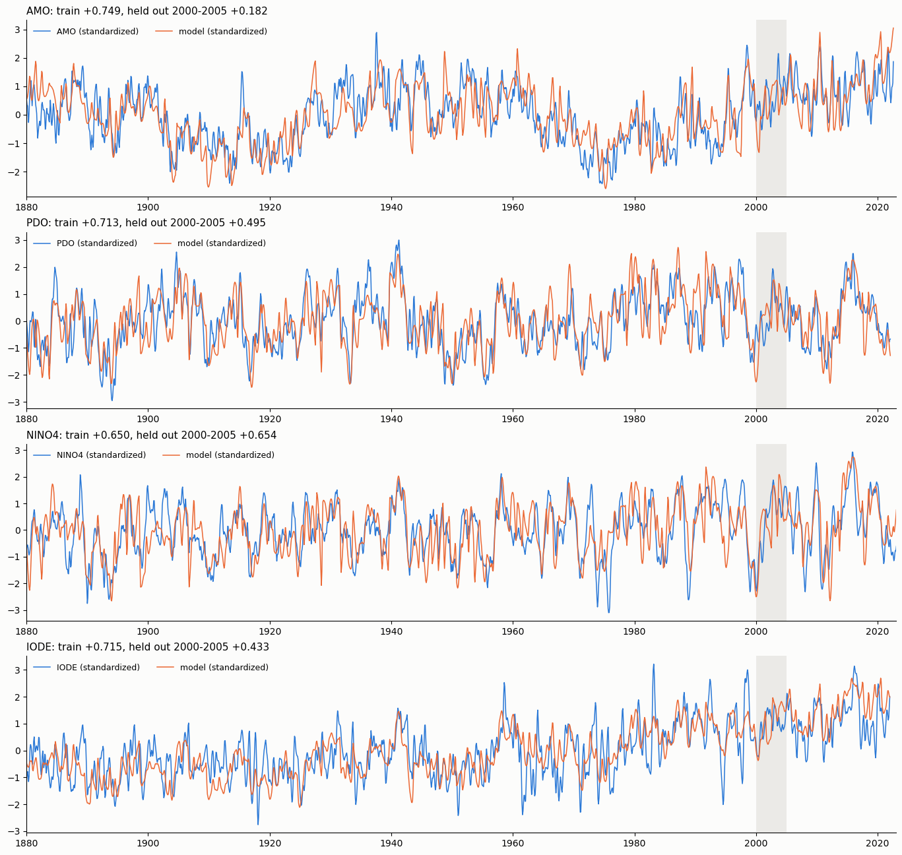
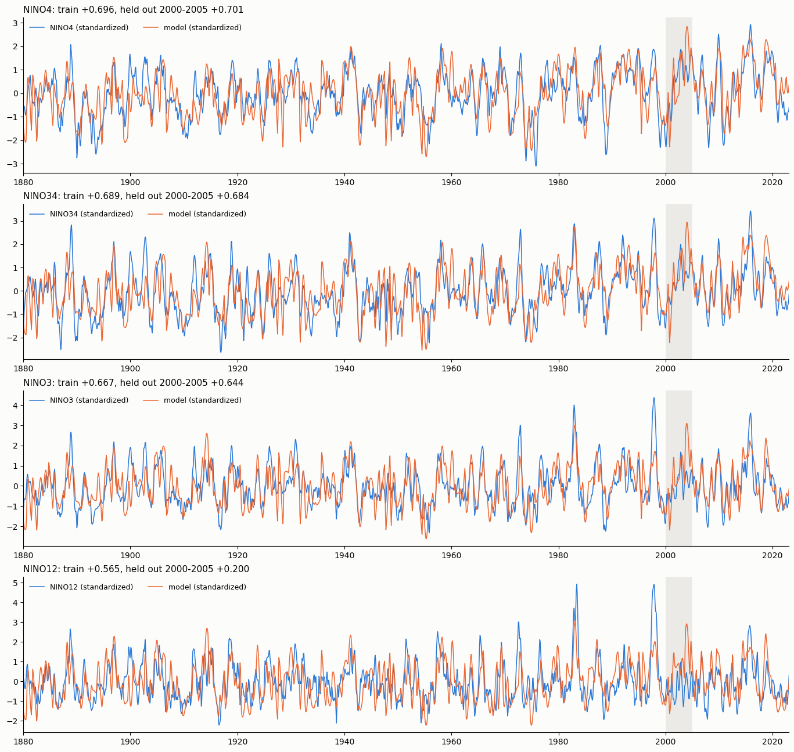
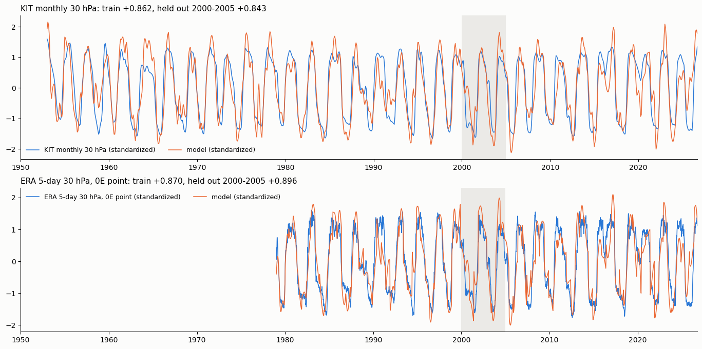
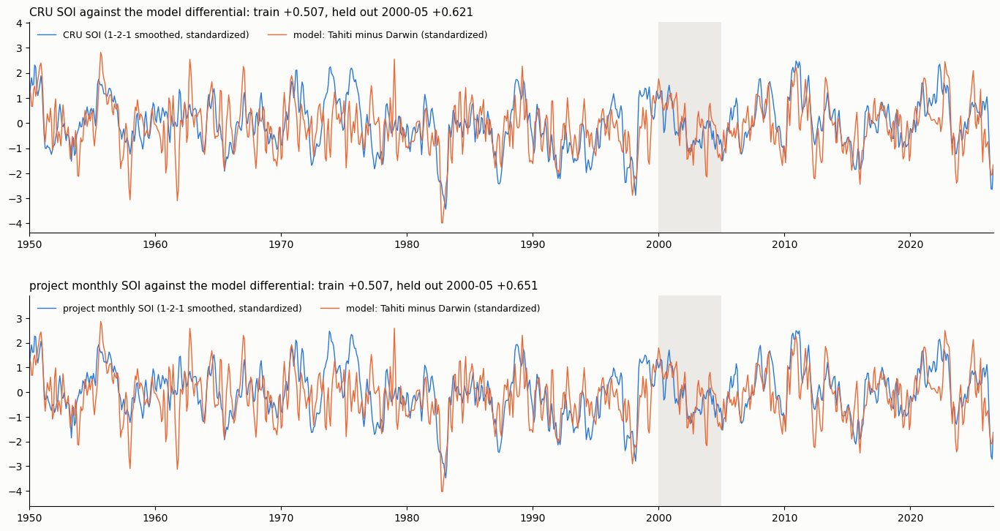
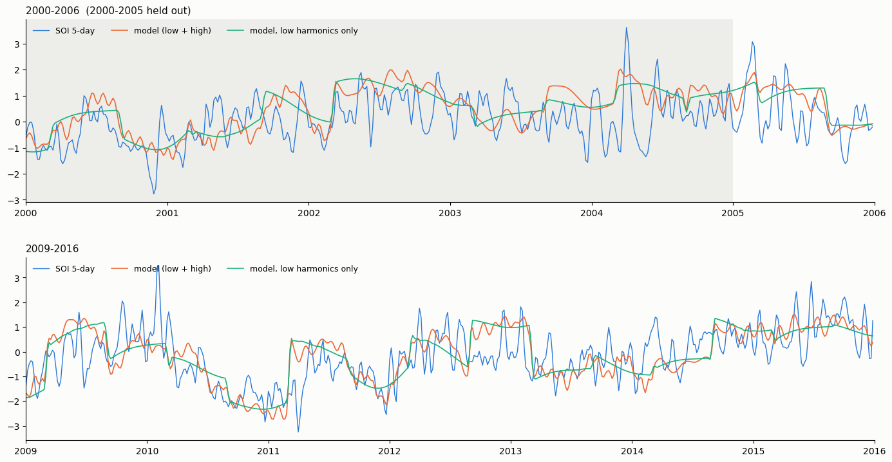

# GEM-LTE Core

Core Ada solver and experiment workspace for the GEM-LTE modelling pipeline.
This repository keeps the LTE engine and the `experiments/Feb2026` research
tools together, but without the broader packaging/setup scripts from
[`pukpr/GEM-LTE`](https://github.com/pukpr/GEM-LTE).

## Selected results: one manifold, several records

Each figure comes from a multi-leg fit (`LEGS N`, see [LEGS.md](LEGS.md)): one shared manifold and set of windings,
with each record regressing its own amplitudes. Model and data are standardized; the shaded years 2000-2005 were held
out of every leg. Run directories are under `experiments/Oct2026_generator/legs/`.



*AMO, PDO, NINO4 and IODE, monthly 1880-2022, four legs on one manifold (`amo_pdo_nino4_iode`). Training correlation
+0.65 to +0.75 (+0.49 to +0.73 with quadratic trends removed); held out 2000-2005: AMO +0.18, PDO +0.50, NINO4 +0.65,
IODE +0.43.*



*The four Nino regions on one manifold (`nino4_34_3_12`): training +0.57 to +0.70, held out +0.64 to +0.70 for NINO4,
NINO34 and NINO3 (NINO12 +0.20). The ninth harmonic of the 0.2017 base winding is the largest term in all four.*



*QBO at 30 hPa (`qbo30_point0E`): the KIT station record (monthly, 1953-2026) and ERA5 at 0N 0E (5-day means,
1979-2026) on one manifold, seeded from the 50 hPa fit. Training +0.86 / +0.87, held out 2000-2005 +0.84 / +0.90.*



*The SOI never fitted directly: Darwin and Tahiti pressure anomalies (CRU, from 1866 and 1861) are fitted as two legs,
and the model's Tahiti-minus-Darwin difference is compared with the official SOI. Against the CRU SOI: training +0.51,
held out 2000-2005 +0.62. The two stations' fitted responses come out as a see-saw by themselves (agreement -0.82).*



*The 5-day SOI (Long Paddock daily data) in a two-leg fit with the monthly CRU SOI (`soi_cru_5day`): the model with its
low harmonics only (green) is a staircase; the high windings (orange) add the sub-seasonal cycling, which matches the
data in the 2-6 month band at +0.20 in training and +0.19 on the held-out years (top panel shaded).*

## Build the Ada solver

This repository builds with GNAT/GPRbuild using `lte.gpr`.

```bash
gprbuild -P lte.gpr enso_opt
```

The project file writes executables into `experiments/Feb2026/`. The Python
helpers there expect the runtime binary to be named `lt` or `lt.exe`, so after
building, stage the produced `enso_opt` executable under that name in
`experiments/Feb2026/`.

Unlike the full `GEM-LTE` repository, this core repo does **not** bundle the
Windows setup/staging scripts, so building and staging the runtime executable is
done directly.

## Essential operation

The main Ada driver is `src/enso_opt.adb`. Runtime fits are controlled by the
per-index files stored under `experiments/Feb2026/<index>/`:

- `<index>.dat` — target time series
- `lt.exe.p` — saved parameter state
- `lt.exe.resp` — runtime options / defaults

Typical workflow:

1. Build `enso_opt` with `gprbuild -P lte.gpr enso_opt`.
2. Stage the binary as `experiments/Feb2026/lt` or
   `experiments/Feb2026/lt.exe`.
3. Run the solver from the experiment workspace with either the GUI or the CLI
   helper wrappers.

## Main usage paths

### GUI workflow

From `experiments/Feb2026/`:

```bash
python3 lte_gui.py
```

The GUI discovers subdirectories that contain `lt.exe.p`, lets you choose an
index/site, and launches the staged `lt` / `lt.exe` binary with the matching
environment variables.

### Command-line run helper

Use `lte_run.py` when you want the same operation as the GUI's **Run lt**
button, but from the shell:

```bash
cd experiments/Feb2026
python3 lte_run.py amo --cv 1880 1885
```

Example with a different metric and timeout:

```bash
python3 lte_run.py nino4 --timeout 3600 --metric DTW
```

### Deterministic forward reproduction

`lte_forward.py` runs the forward model only, without the Ada random-descent
optimizer:

```bash
cd experiments/Feb2026
python3 lte_forward.py amo --verify
```

This is the easiest way to inspect the saved forcing/manifold/LTE pipeline for a
given parameter set.

### Local parameter sweeps

`lte_sweep.py` runs isolated sweeps around a saved fit:

```bash
cd experiments/Feb2026
python3 lte_sweep.py amo --target 0.9 --timeout 300
```

## Repository layout

- `src/` — Ada packages and drivers
- `lte.gpr` — GNAT project file
- `experiments/Feb2026/` — primary research workspace, index datasets, GUI, and
  analysis helpers
- `experiments/rr/` — round-robin / pared-down helper workspace

## See also

- `experiments/README.md`
- `experiments/Feb2026/README.md`
- `experiments/Feb2026/RECIPE_FOR_RESEARCHERS.md`
