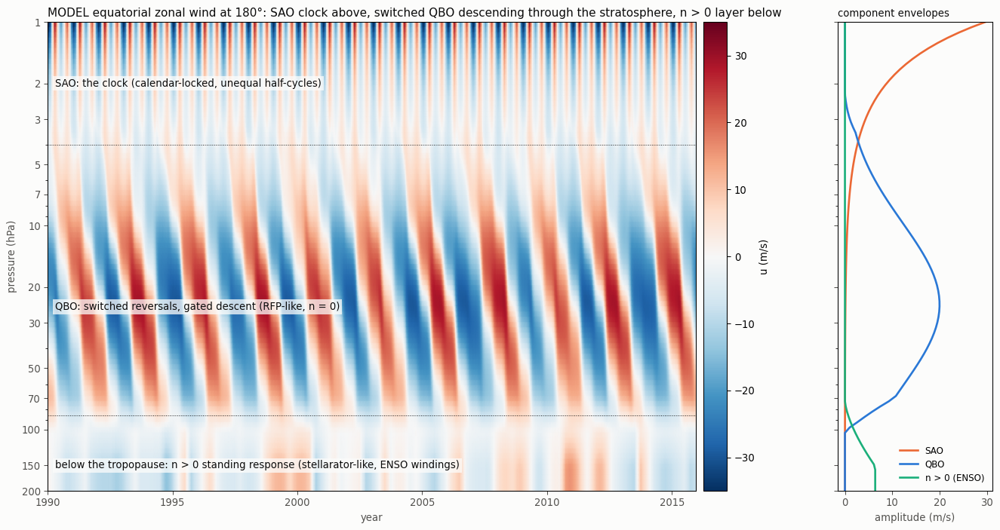
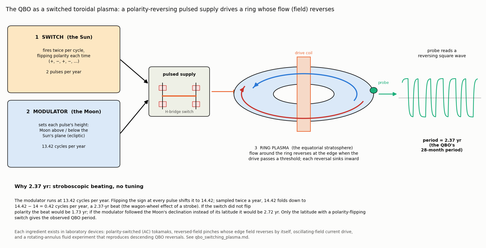
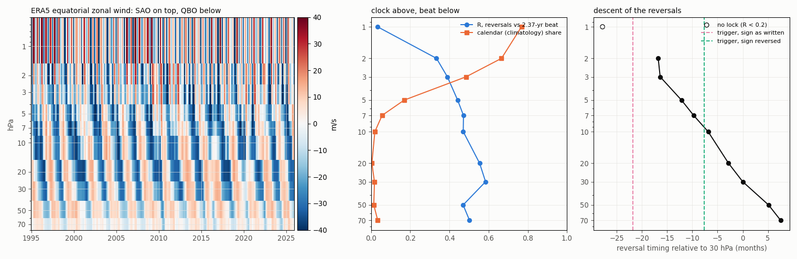
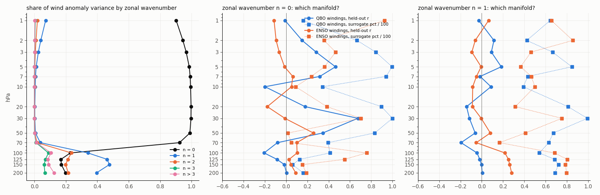
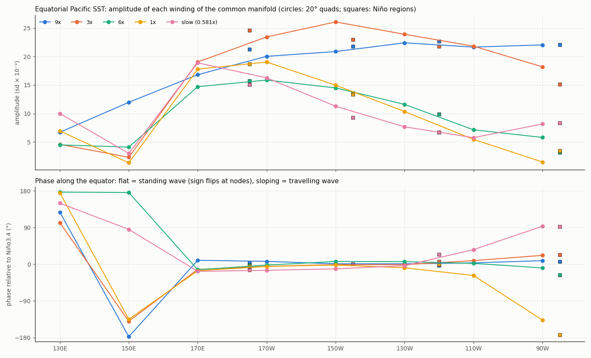

# GEM-LTE and magnetohydrodynamics: a supplementary view

This directory is a **supplementary view of the GEM-LTE model** that applies its equivalence to
magnetohydrodynamics (MHD). The core model (in `src/` and `experiments/`) solves Laplace's tidal equations with tidal
forcing on a shared manifold. The documents here ask what that model looks like when read as a toroidal plasma
device:
- steady Euler flow and MHD equilibrium obey the same equations;
- rotation and gravity enter as the absolute vorticity (in place of current) and the Bernoulli function (in place of
  pressure);
- the curl-free tidal force plays the part of external coils.

Three device types organize the picture: the **tokamak** (axisymmetric), the **reversed-field pinch** (axisymmetric,
with a self-reversing toroidal field) and the **stellarator** (non-axisymmetric, longitude-selective).

*The unified view (`model_column.py`): a model of the equatorial zonal wind from 1 to 200 hPa.*
- *At the top, the semiannual oscillation (SAO): a calendar-locked clock.*
- *Through the stratosphere, the QBO: switched reversals that descend, the reversed-field-pinch layer with zonal
  wavenumber n = 0.*
- *Below the tropopause, a longitude-pinned standing response driven by the ENSO windings: the stellarator layer,
  n > 0.*

*The structure is modelled, not fitted point by point; the drive timing, gating and ENSO response come from the fits
described below.*

## Documents

| Document | What it covers |
|---|---|
| [landreman_gfd_synthesis_framework.md](landreman_gfd_synthesis_framework.md) | The original framework note mapping Landreman's analytic 3D MHD equilibria (arXiv:2609.26742) onto GEM-LTE. Kept unchanged for reference; its unsupported claims are corrected in the next document. |
| [landreman_lte_synthesis.md](landreman_lte_synthesis.md) | The checked synthesis. The exact link: the LTE response is a harmonic oscillator in the manifold, so fitted windings act like field lines with a rotational transform. Empirical tests, and section 8: the MHD ↔ rotating-fluid factor table, poloidal versus toroidal forcing, and the ENSO evidence (pinned standing mode, ORAS5 thermocline). |
| [qbo_tokamak.md](qbo_tokamak.md) | The detailed QBO device. A reversing poloidal drive; the comb impulse and the lunar ecliptic-latitude modulation, giving the 2.370-yr beat; the saturating core and strobe-gated penetration that make the shoulders; the helical, high-winding ripple; and the QBO record read as an MHD "shot" (1 yr = 1 s). |
| [qbo_switching_plasma.md](qbo_switching_plasma.md) | The short version: the QBO as a switched toroidal plasma, with existing laboratory systems for each ingredient (AC tokamaks, reversed-field pinches, oscillating-field current drive, the Plumb–McEwan tank). Phase-locking, absolute-phase and SAO tests. |
| [stellarator_emulation.md](stellarator_emulation.md) | The stellarator layer. Within the Pacific basin ENSO acts as one standing mode. In the equatorial winds, wavenumber > 0 emerges below 70 hPa and follows the ENSO windings, while the zonal-mean flow above follows the QBO. |

## Selected figures

*The short version as a schematic. A switch (the Sun) fires twice per cycle with alternating polarity. A modulator (the
Moon's ecliptic latitude) sets each pulse's height. A ring plasma reverses its edge flow when the drive passes a
threshold. The stroboscopic beat gives the QBO's 2.37-yr period with nothing tuned.*

*ERA5 equatorial winds, 1–70 hPa.*
- *Left: the time–height field.*
- *Centre: the calendar dominates at the SAO level, and the 2.37-yr beat takes hold below it.*
- *Right: reversals first appear at 2–3 hPa, then descend at about 1 km per month.*

*The split between layers, by zonal wavenumber.*
- *The zonal-mean share of the variance falls from 0.92 to 0.23 between 70 and 100 hPa.*
- *Above that boundary the zonal-mean flow follows the QBO windings; below it, wavenumbers 1–2 follow the ENSO
  windings.*

*ENSO's spatial structure. Each winding's amplitude and phase along the equatorial Pacific: one phase east of a node near
160°E, with Darwin and Tahiti pressure locked in opposite phase. A standing wave, not a travelling one.*

## Code and data

- Every figure has a script of the same name (`*.py`). The scripts read fitted runs from
  `experiments/Oct2026_generator/legs` and data fetched with:
  - `experiments/Oct2026_generator/ORAS5/fetch_d20.py` (ORAS5 20 °C isotherm depth);
  - `experiments/Oct2026_generator/SAO/fetch_sao.py` and `fetch_low.py` (ERA5 equatorial winds, 1–200 hPa).

  The downloaded data files are not in the repository; the fetch scripts regenerate them.
- `basin.py` and `basin_empirical.py` draw the torus picture: the first is generic, the second uses the fitted windings.
- `GEM_Chap11.tex` and `GEM_Chap12.tex` are the chapter sources for the original LTE derivation. `lte_mod.jpeg` and
  `twisty_wave.png` are the original illustrations.

These documents are exploratory. Where a result is negative or not yet decisive, the documents say so (for example,
the post-2006 QBO phase step, and the lack of winding-selective modes within the Pacific basin).
