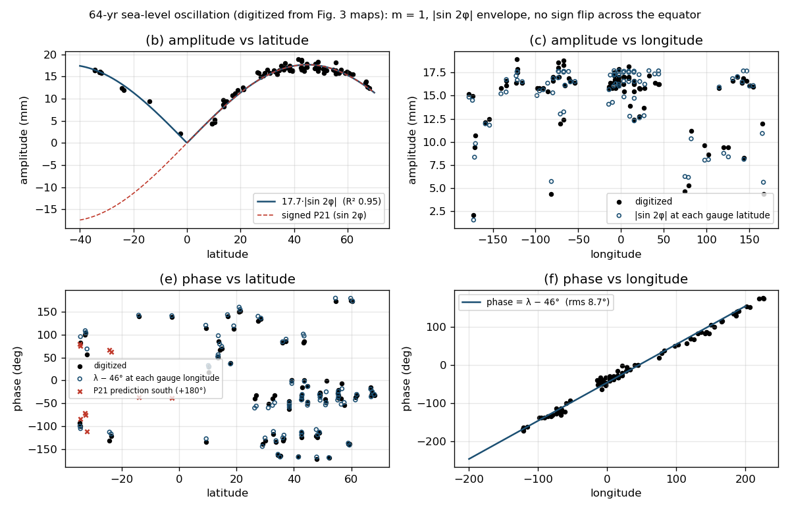

# The 64-yr sea-level oscillation as a tesseral (order-1) mode

2026-11-05. This note fits the spatial pattern of the global ~64-yr sea-level oscillation to tesseral
(order-1) geometry, and works out the tesseral annual alias (OO1, 59 yr) that GEM-LTE would
attach to it. It also covers a first per-leg test of that term in the 4-leg NINO4/AMO/PDO/IOD-E
co-fit.

Source figure: Fig. 3 of *The global 64-year sea level oscillation and its possible external
excitation sources* (Science China Earth Sciences,
<https://files.sciengine.com/pdfs/1674-7313/BF5E10A9A78D449CBE090BB90C5A6EC6.pdf>). The figure
itself is not included here. The scripts read a local copy saved as `fig3.png`.

## Summary

| property | result from Fig. 3 | tesseral degree-2, order-1 (P21) expectation |
|---|---|---|
| amplitude vs latitude | 17.7·\|sin 2φ\| mm, R² = 0.95, rms 0.8 mm; free shape \|sin φ\|^p cos^q φ gives p = q = 0.95, peak at 45.0° | \|sin 2φ\|, peak at 45° — **matches** |
| phase vs longitude | phase = λ − 46°, slope **+1.00**, circular rms **8.7°** (m = 0, ±2, −1: 80–94°) | slope ±1 — **matches** |
| amplitude vs longitude, phase vs latitude | fully explained by the two fits above (residual r ≈ −0.2 and +0.28) | — |
| sign across the equator | **no flip**: southern gauges sit on the same λ − 46° line (mean residual −5°). Forcing the flip raises the rms from 8.7° to 56° | sin φ cos φ is odd, so the south should be 180° out of phase — **does not match** |

Three of the four geometric properties are exactly tesseral. The fourth is not: the pattern is
\|sin 2φ\|·cos(ωt − λ + c). It is even in latitude and zero at the equator. No single spherical
harmonic has that shape. An even order-1 field needs odd degrees (P11, P31, …), and none of them
vanishes at the equator on its own.

## 1. Digitizing Fig. 3

The scatter panels (b, c, e, f) have no labels saying which dot is which gauge. The two maps do:
- (a) gives amplitude as colour at each gauge location;
- (d) gives phase as colour at each gauge location.

`maps.py` pairs them:
- It calibrates both maps as equirectangular, from the tick labels (84.3 px per 90° of longitude,
  56.25 px per 60° of latitude).
- It reads each colour bar along its centre row (0–30 mm; −180° to +180°).
- It takes every saturated (coloured) blob in map (a) and splits large blobs into 6×6 px cells, so
  that clustered gauges keep their own colours.
- For each cell it reads the colour at the same position in map (d), 223 px lower.
- It maps both colours to values by nearest colour-bar match.

Cells with a poor colour match (RGB distance ≥ 25) are dropped, which removes antialiased edges and
labels. That leaves 87 cells spanning 34.5°S to 68°N, 10 of them in the south. The expected
precision is about ±1 mm in amplitude and ±5° in phase. Dense clusters such as Europe and Japan are
merged into cells.

`digitize.py` independently extracts the black dots from the scatter panels, as a cross-check. The
panel (f) dots alone give slope 1.02 and intercept −43°. The panel (b) dots give A = 18.4 mm. Both
agree with the map-based fit.

`fit.py` holds the fits:
- one-parameter amplitude fits A·shape(φ);
- circular least squares for phase = m·λ + c, with and without a +180° offset in the south;
- a free-slope phase fit;
- a free amplitude shape \|sin φ\|^p cos^q φ.

| amplitude shape | A (mm) | rms (mm) | R² |
|---|---|---|---|
| **\|sin 2φ\| (P21)** | **17.7** | **0.82** | **+0.95** |
| \|sin φ\| (P10) | 23.2 | 3.49 | +0.09 |
| constant | 14.8 | 3.55 | 0 |
| cos²φ (P22) | 20.3 | 7.99 | −3.44 |
| \|3 sin²φ − 1\|/2 (P20) | 30.8 | 9.97 | −4.65 |

| phase model | c | circular rms |
|---|---|---|
| **m = +1, no southern flip** | **−46.5°** | **8.7°** |
| m = +1, south + 180° | −25.5° | 56.3° |
| m = 0 | −57° | 91.6° |
| m = −1 | −76.5° | 93.5° |
| m = ±2 | — | 81.6–88.2° |
| free slope | m = +1.00, c = −46° | 8.7° |

A uniformly random phase would give an rms of about 104°.

## 2. The tesseral alias in Doodson form

Diurnal tidal lines are order 1. Sampled once a year and accumulated, as by the annual impulse in
GEM-LTE, each one leaves a slow remainder:

    f_alias = Mod(Y_s / P + 1/2, 1) − 1/2        (cycles per year)
    T       = 1 / | Mod(Y_s / P + 1/2, 1) − 1/2 |

Here Y_s is the impulse spacing (the fitted model year, 365.24629 d) and P is the line period in
days. In a spreadsheet: `=1/ABS(MOD(A1/B1+0.5,1)-0.5)`.

**OO1** has Doodson number 185.555, n = (1, 3, 0, 0, 0, 0), argument τ + 3s:
- Frequency: 1 + 2/T_m + 1/Y_t cycles per day = 1.0759401 cpd.
- Period: P_OO1 = **0.92941976 d** (22.3061 h).
- Cycles per year: Y_s / P_OO1 = 392.98313, so f_alias = −0.01687 cpy and **T = 59.3 yr**.
- The period needs 8 significant digits. Rounding it to 0.9294206 d gives 58.05 yr.

Because the alias is linear in the Doodson numbers, f_alias = Σ nᵢ aᵢ (mod 1). At
Y_s = 365.24629 d the basis aᵢ = frac(Y_s·rateᵢ) is:

| a_τ | a_s | a_h | a_p | a_N′ | a_p₁ |
|---|---|---|---|---|---|
| −0.122115 | +0.368417 | +0.000011 | +0.113032 | +0.053726 | +0.000048 |

alias(OO1) = a_τ + 3a_s = −0.01687 cpy.

**Same thing, split into K1 + Mf.** OO1 = K1 + Mf (the prograde half of the fortnightly
nutation; O1 = K1 − Mf is the retrograde half). Over one year:
- 366.24630 K1 cycles (sidereal days), leaving the fractional day +0.24630;
- 26.73683 Mf cycles, leaving the Mf alias −0.26317;
- 392.98313 in total, nearest whole number 393, remainder −0.01687.

The 59.3 yr is the Mf alias (3.80 yr) beating against the diurnal-carrier alias (4.06 yr).

Consequences:

- **SO1 (183.555) ≡ OO1** (59.21 yr). a_h is only 1.1×10⁻⁵, so lines that differ only in n₃
  can't be separated by annual aliasing. The same is why Msf ≡ Mf, and K1 ≡ P1 ≡ S1.
- **Nodal satellites:** 185.565 → 27.1 yr and 185.575 → 11.0 yr.
- **Sensitivity to the year length:** ∂f/∂Y_s = n·rates = 1.076 cpy per day, about 10× Mt's
  0.11. So OO1's alias period depends strongly on which "year" paces the impulse:

| impulse spacing | Y_s (d) | OO1 alias |
|---|---|---|
| tropical year | 365.242189 | 47.0 yr |
| model fit | 365.24629 | 59.3 yr |
| (exactly 64 yr) | 365.247443 | 64.0 yr |
| Julian year | 365.25 | 77.7 yr |
| sidereal year | 365.256363 | 166 yr |
| anomalistic year | 365.259636 | 399 yr |

- **Relation to Mt:** Mtm = (0, 3, 0, −1, 0, 0) aliases to −0.00778 cpy (128.5 yr; second harmonic
  64.3 yr). Exactly, alias(OO1) = alias(Mtm) + (a_τ + a_p). The second term is the K1 − Mm line
  (24.83 h, 110 yr). The two cycles are not harmonically locked: they are 59.3 / 128.5 yr at the
  model year, but 47.0 / 120.4 yr at the tropical year.
- **Geometry:** the diurnal potential is ∝ sin 2φ·cos(V + λ). The annual sample becomes
  sin 2φ·cos(λ + 2π f_alias t + φ₀). That is a wavenumber-1 pattern rotating once around the globe
  per 59.3 yr, eastward because f_alias < 0. This is the Fig. 3 geometry, except for the sign
  across the equator.
- **Timing requirement:** the unit longitude slope survives only if the yearly impulse is one
  global instant (UT). If the impulse is locked to each site's local solar time, the phase becomes
  2π f t_L + (1 − f)·λ, giving a slope of −0.076 for OO1 and −0.003 for K1. The impulse must also
  be sharp to within a few hours, or the diurnal carrier averages away.
- **Accumulation:** accumulation (the IIR stage) favours slow aliases, roughly in proportion to
  their period: about 16× for OO1 and 34× for Mt, relative to the 3.8-yr Mf alias. These are upper
  bounds, since the integrator leaks.

### Order m sets the longitude wavenumber

The first Doodson digit n₁ is the order m. It becomes the longitude wavenumber of the aliased
pattern, and it adds n₁ × frac(Y_s) to the yearly slip.

| family (n₁ = m) | latitude shape | longitude phase | examples |
|---|---|---|---|
| zonal, 0 | 3 sin²φ − 1 (largest at the equator) | none | Mf 3.8 yr, Mt 128.5 yr |
| tesseral, 1 | sin 2φ (zero at the equator) | +1 cycle per 360° | OO1 59.3 yr, K1 4.06 yr, O1 2.04 yr |
| sectorial, 2 | cos²φ (largest at the equator) | +2 cycles per 360° | semidiurnal family |

## 3. Projection onto the climate-index boxes

Area-weighted box means of the two latitude shapes (equilibrium shapes, not LTE responses):

| index box | sin 2φ (tesseral) | (3 sin²φ − 1)/2 (zonal) |
|---|---|---|
| NINO4 / NINO3.4 (5°S–5°N) | **0.000** | −0.496 |
| IOD-E (10°S–0°) | −0.172 (+0.172 if even, as Fig. 3 shows) | −0.485 |
| TNA (5.5–23.5°N) | +0.473 | −0.397 |
| AMO (0–70°N) | **+0.681** | **−0.059** |
| PDO (20–70°N) | +0.881 | +0.161 |

- An equatorial box cancels the tesseral shape exactly, so ENSO takes it only through its own
  north–south asymmetry.
- The AMO box sees 68% of the tesseral shape, while the zonal shape nearly cancels across its 35°N
  node.
- For a pattern rotating eastward at 59.3 yr, the AMO box (about 40°W) should lag the North
  Pacific (about 175°W) by 135°, i.e. 22 yr.

## 4. Per-leg test in lt.exe: `TESS_PERIOD`

New option, off by default. With the environment variable `TESS_PERIOD=<days>`, the closed-form
regression adds a per-leg sin/cos pair at the signed alias Mod(Year/P + ½, 1) − ½ of that line. It
uses the same mechanism as the Chandler-wobble pair and adds no search parameters. The coefficients
are written to `lt.exe.windings.N.json` under `"tess"` (`freq`, `sin`, `cos`). With the variable
unset, scores are byte-identical to the previous binary.

Test: score-only runs of the 4-leg co-fit (`nino4_amo_pdo_iode_seed_cofit/s2_fit.p`, copied to
`experiments/Oct2026_generator/legs/cofit4_tess/`), with `TESS_PERIOD=0.92941976`:

| leg | train CC without → with | amplitude / data std | geometric weight |
|---|---|---|---|
| NINO4 | 0.725 → 0.726 | 0.09 | 0 |
| AMO | 0.684 → **0.750** | **0.24** | 0.68 |
| PDO | 0.692 → 0.707 | 0.10 | 0.88 |
| IOD-E | 0.709 → 0.722 | 0.12 | ∓0.17 |

The 2000–05 hold-out cannot test a 59-yr term. AMO's hold-out moves from −0.03 to +0.05.

Null scan over the alias period, both directions (`tess_scan.txt`):

| period (yr) | 30 | 50 | 55 | **59.3** | 65 | 70 | 80 | 100 | 200 |
|---|---|---|---|---|---|---|---|---|---|
| AMO train CC | 0.686 | 0.694 | 0.723 | **0.750** | 0.765 | 0.765 | 0.755 | 0.741 | 0.727 |
| AMO lag behind PDO (yr) | — | 10 | 16 | **19** | 22 | 25 | 32 | 44 | — |

- **59.3 yr is not singled out.** AMO prefers 65–70 yr, nearer the Mt harmonic (63.7 yr) and the
  64-yr sea-level mode.
- **Direction:** +f and −f fit identically; direction shows only through the sign of the AMO–PDO
  lag. Eastward rotation predicts AMO lagging by about 22 yr. The fit gives 19 yr (at 59.3 yr) to
  22 yr (at 65 yr), the right sign and size. A generic shared AMO–PDO multidecadal lag would behave
  similarly, and the PDO index is an EOF dipole, not a box mean.
- **IOD-E's phase disagrees** (−159° observed against −40° predicted, or +140° with the even
  pattern of Fig. 3). Its weight is small and its phase is poorly determined.

## 5. Assessment

- The 64-yr sea-level oscillation is a wavenumber-1 pattern to within digitizing precision, with
  phase slope exactly one and a \|sin 2φ\| envelope peaking at 45°. That is the order-1 (tesseral)
  geometry of the pole tide and the diurnal tidal potential.
- It is not a signed P21 field. The southern hemisphere is in phase with the northern, which no
  equilibrium order-1 tide or pole tide produces.
  - A response to the magnitude of an odd forcing would produce it, for example one scaled by \|f\|
    (the Coriolis magnitude), which flips with the forcing and cancels its sign. This is untested.
  - The 0.5″ of 64-yr polar motion that an equilibrium pole tide would need (about 0.037 mm/mas at
    45°) is about 20× the observed decadal polar motion.
- OO1 has the right order and envelope. Its period (59.3 yr at the fitted year) is too
  year-length-sensitive to count as evidence, and the multi-leg period scan prefers 65–70 yr. The
  tesseral term is compatible with the indices (no ENSO share, a large AMO share, an AMO–PDO lag of
  the right sign) but not yet distinguished from a generic multidecadal cycle. It adds no factor to
  the significance estimate as it stands.
- A sharper multi-leg test would fix every leg's weight and phase from geometry, leaving one global
  amplitude and phase. That would use box-mean indices (AMO, NINO, IOD-E, TNA) and the even
  \|sin 2φ\| envelope that Fig. 3 actually shows.

## 6. Related: which tidal lines the NINO4 forcing uses (`ephemeris/`)

These scripts back the ephemeris comparison of the high-resolution NINO4 fit
(`ephemeris/nino4_hires_fit.p`, a copy of `legs/nino4_slow_then_harm/lt.exe.p` as analysed). Run
them from inside `ephemeris/`.

- `meeus_lines.py`: line content of the Meeus ch. 47 zonal potential and its rate at the fit's
  periods. The fit's 40 periods explain 99.98% of the Meeus rate. Mf comes out within 5° of the
  Meeus phase. The Meeus-amplitude-weighted phase test gives p = 0.014.
- `residual.py`: the Meeus zonal residual after the fit's periods is 0.02%, so no zonal line is
  missing.
- `asym.py`, `asym_resid.py`: the odd-parity forcing (a/r)³ sin δ predicts a draconic/tropical
  ratio of 0.208 at 0°. The fit has 0.257 at +7°. The odd lines missing from the table are led by
  13.7188 d (tropical + anomalistic, 27% of the tropical line, aliasing to 2.66 yr).
- `c04_lines.py`: observed IERS C04 LOD (`eopc04.1962-now`, downloaded separately) follows the
  equilibrium potential to within about 10%. The departures are 27.67 d (+29%, stable in both
  halves of the record), 27.09 d (+18%) and Msm (+10%), which are Ding & Chao's resolved lines. The
  odd 27.32/27.21 d pair is at noise level in LOD, as expected.

## Files

| file | content |
|---|---|
| `maps.py` | map digitizer: `python3 maps.py fig3.png` → `map_points.json` |
| `digitize.py` | scatter-panel digitizer: `python3 digitize.py fig3.png` → `fig3_points.json` |
| `fit.py` | the fits in §1 |
| `map_points.json`, `fig3_points.json` | the digitized values |
| `sl64_tesseral_fit.png` | the figure above |
| `tess_scan.txt` | the §4 period scan |
| `ephemeris/` | §6 |

The `TESS_PERIOD` code lives in `src/gem.ads`, `src/gem-lte-primitives.ads/.adb`,
`src/gem-lte-primitives-solution.adb` and `src/gem-lte-primitives-shared.ads/.adb`.
