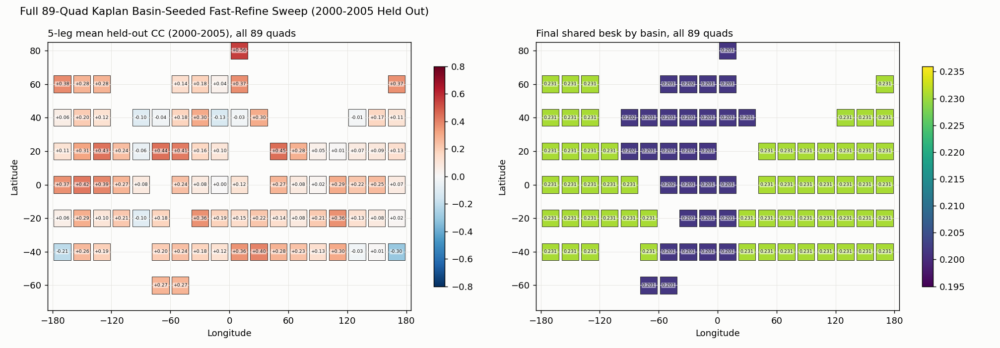
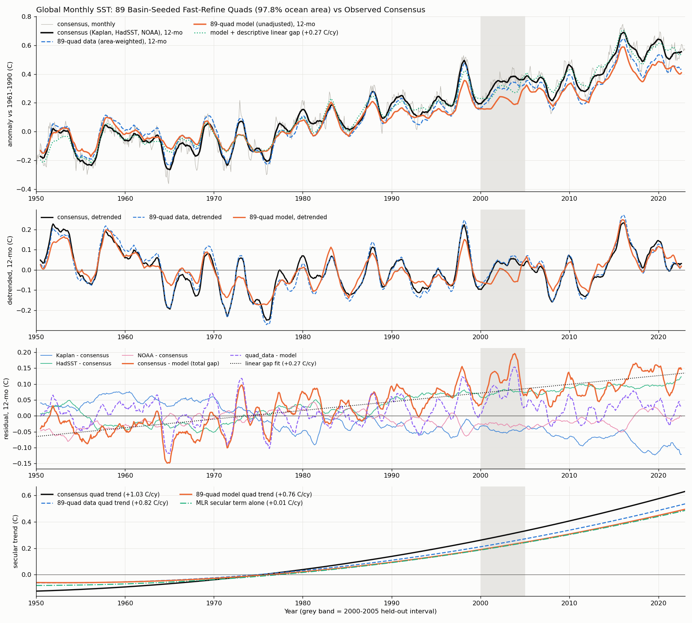
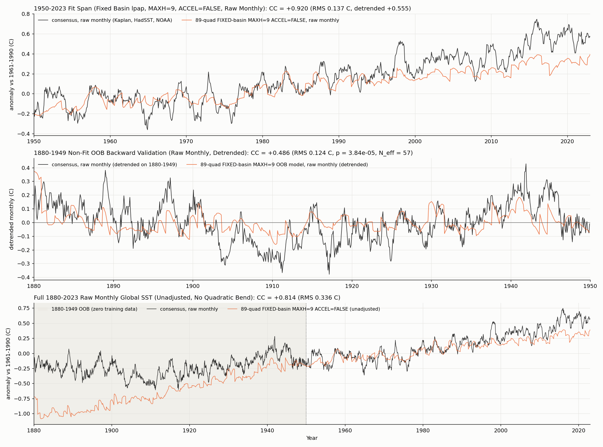

# Oct2026_quad5_besk — Full 89-Quad Basin-Seeded Fast-Refine Sweep & 1880–2023 Global SST OOB Validation

## Overview

This experiment runs the full **89-quad Kaplan SST V2** global five-leg sweep (97.8% of Kaplan global ocean area) using the native Ada `REFINE=TRUE` optimizer ([`src/gem-lte-primitives-refine.adb`](../../src/gem-lte-primitives-refine.adb)), seeded by ocean basin from the refined climate-index family fits:

| Basin | Quads | Seed source | `besk` | `ltep[2]` |
|---|---:|---|---:|---:|
| **Atlantic** | 30 | `atlantic_family` + AMO (leg 3) | `0.2014` | `-0.2019` |
| **Pacific** | 41 | `indopacific_family` + NINO4 (leg 1) | `0.2306` | `+0.2309` |
| **Indian** | 18 | `indopacific_family` + IODE (leg 3) | `0.2306` | `+0.2304` |

Basin assignments for all 89 quads are stored in [`all89_basins.json`](all89_basins.json) (verified 30/30 against [`sample.json`](sample.json)).

### Solver Updates (`src/gem-lte-primitives-refine.adb`)
- Added **`Block_B_Shared`** and **`Block_C_Harm_Shared`** for shared-parameter multi-leg runs (`LEG_WINDINGS` / `LEG_P` off, `Own_None`), jointly optimizing `(impA, impB, besk, offset, bg, ltep, IR)` and harmonics across all 5 legs simultaneously.
- Added **`REFINE_ANCHOR_SEED=TRUE`** so the quadratic `lpap` prior anchors gently to the basin climate-index seed (`Th_0`, `dLOD ≈ 0.984`) rather than pulling `lpap` back toward raw `LPRef`.
- Guarded `Shared.Write_Leg` so per-leg `lt.exe.p.1..5` files are not written in `Own_None` mode.

---

## 1. Full 89-Quad Basin-Seeded Fast-Refine Sweep (`quad5_besk_sweep.py`)

Settings: `REFINE_ANCHOR_SEED=TRUE`, `REFINE_LAM=1.5`, 3 rounds × 8 iters, `REFINE_HARM_SCREEN=TRUE` (`max_swaps=2`, `min_gain=0.002`), `ACCEL=TRUE`, `MANIFOLD_PRE=TRUE`, `2000–2005` held out. Mean Ada `REFINE` time: **`10.37 s` per 5-leg quad** (~25 min wall time for all 89 quads + unfiltered `F9=-1` rescores).

| Basin | Quads | `besk` median `[min..max]` | Train 5-leg (seed → ref) | Held-out `2000–2005` 5-leg mean (med) | Centre held-out | Mean `dLOD` | Neighbour agree |
|---|---:|---|---:|---:|---:|---:|---:|
| **Atlantic** | 30 | `0.2014` `[0.2014..0.2015]` | `0.663 → 0.772` | `+0.181` (`+0.179`) | `+0.203` | `0.9822` | `+0.45` |
| **Pacific** | 41 | `0.2306` `[0.2305..0.2307]` | `0.641 → 0.757` | `+0.159` (`+0.173`) | `+0.165` | `0.9847` | `+0.51` |
| **Indian** | 18 | `0.2307` `[0.2306..0.2308]` | `0.693 → 0.800` | `+0.211` (`+0.228`) | `+0.238` | `0.9846` | `+0.74` |
| **ALL** | **89** | `0.2306` `[0.2014..0.2308]` | **`0.659 → 0.771`** | **`+0.177`** (`+0.180`) | **`+0.193`** | **`0.9839`** | **`+0.53`** |

Full per-quad table: [`quad5_besk_89_summary.csv`](quad5_besk_89_summary.csv).

---

## 2. Monthly Global SST Reconstruction & Missing-Trend Budget (`1950–2023`)

Ocean-area-weighted average of the 89 unfiltered (`F9=-1`, `ACCEL=TRUE`) centre-leg models vs the 3-dataset observed consensus (**Kaplan V2**, **HadSST 4.2.0.0**, **NOAA ERSST v5**), 877 common months (`1961–1990` baseline).

| Series | Target | Monthly CC / RMS | Detr (lin) CC | Detr (quad) CC | 12-mo CC | Detr 12-mo CC | Held `2000–2005` |
|---|---|---:|---:|---:|---:|---:|---:|
| **89-quad model (unadjusted)** | 3-dataset consensus | **`+0.970` / `0.085 °C`** | **`+0.870`** | `+0.841` | **`+0.986`** | **`+0.929`** | `+0.463` |
| **89-quad model + linear gap** *(descriptive)* | 3-dataset consensus | **`+0.973` / `0.057 °C`** | `+0.870` | `+0.841` | **`+0.987`** | `+0.929` | `+0.494` |
| **89-quad model (unadjusted)** | **89-quad observed data** | **`+0.964` / `0.060 °C`** | **`+0.893`** | **`+0.871`** | **`+0.984`** | **`+0.949`** | `+0.457` |
| 89-quad observed data | 3-dataset consensus | `+0.984` / `0.058 °C` | `+0.974` | `+0.968` | `+0.987` | `+0.978` | `+0.976` |

### Descriptive Missing-Trend Decomposition (`1950–2023`)
- **Quadratic curvature match**: model `c2 = +1.14 × 10⁻⁴ °C/yr²` vs consensus `c2 = +1.14 × 10⁻⁴ °C/yr²` (gap `+1.88 × 10⁻⁷ °C/yr²`).
- **Linear trend gap (`consensus − model = +0.27 °C/century`, `+0.200 °C` over 73 yr)**:
  1. Model vs 89-quad data (`quad_data − model`): **`+0.06 °C/century`** (93% of training-data trend captured).
  2. 89-quad spatial sampling (`Kaplan − quad_data`): **`0.00 °C/century`**.
  3. Dataset offset (`consensus − Kaplan`): **`+0.22 °C/century`** (81% of the total gap is the historical trend difference between Kaplan V2 and HadSST 4.2 / NOAA ERSST v5).
- Adding the descriptive `+0.27 °C/century` linear gap reduces monthly RMS vs consensus to **`0.057 °C`**, matching Kaplan V2's own `0.058 °C` RMS against the consensus.

---

## 3. 70-Year Non-Fit OOB Backward Validation (`1880–1949`, Raw Monthly, No 12-Month Smoothing)

Extrapolating all 89 quads backward to `1880` (`EXCLUDE=FALSE`, `TRAIN_START=1950.0`, `TRAIN_END=2023.0`, zero pre-1950 training data) revealed a sharp diagnostic contrast between per-quad refined manifolds (`MAXH=30`, `ACCEL=TRUE`) and **fixed basin `lpap` manifolds (`MAXH=9`, `NH=5`, `ACCEL=FALSE`)**:

| Metric (Raw Monthly, No 12-Mo Smoothing) | Per-quad `lpap`, `MAXH=30`, `ACCEL=TRUE` | **Fixed basin `lpap`, `MAXH=9`, `ACCEL=FALSE`** |
|---|---:|---:|
| **Spatial coherence (`global_var / mean_quad_var`)** | `0.1253 → 0.0286` (**`4.38×` collapse**) | **`0.1062 → 0.1380` (`0.77×` — no collapse)** |
| **Global-mean detr std ratio (OOB / Fit)** *(obs `1.275`)* | `0.559` | **`1.274`** *(matches obs)* |
| **`1950–2023` (fit)** raw / detrended monthly CC | `+0.970` / `+0.859` | `+0.920` / `+0.555` |
| **`1880–1949` (70-yr OOB)** detrended monthly CC | `+0.244` (`p = 1.39e-2`) | **`+0.486` (`p = 3.84e-5`, $N_{\text{eff}} = 57$)** |
| **`1915–1949` (0–35 yr OOB)** raw / detrended CC | `+0.490` / `+0.256` | **`+0.757` / `+0.474` (`p = 3.22e-4`)** |
| **`1880–1914` (35–70 yr OOB)** detrended / quad-detr CC | `-0.009` / `-0.004` | **`+0.310` / `+0.339` (`p = 0.052`)** |
| **OOB ENSO band (`2–7 yr`)** CC *(vs fit)* | `+0.244` *(fit `+0.886`)* | **`+0.609`** *(fit `+0.705`)* |
| **OOB Decadal band (`> 7 yr`)** CC *(vs fit)* | `+0.380` *(fit `+0.946`)* | **`+0.567`** *(fit `+0.558`)* |
| **OOB Fast band (`< 2 yr`)** CC *(vs fit)* | `+0.040` *(fit `+0.509`)* | `+0.075` *(fit `+0.119`)* |

### Diagnosis
- Under per-quad `lpap` + `MAXH=30` + `ACCEL=TRUE`, individual quads retain full variance in `1880–1949` (`0.285 °C` vs `0.243 °C` in `1950–2023`), but independent per-quad `lpap` drift and high-order harmonics (`10×..30×`) dephase across quads and cancel **77%** of global variance (`4.38×` coherence drop), while `ACCEL=TRUE` bends upward (`+0.48 °C` at 1880).
- Switching to **fixed basin `lpap` + `MAXH=9` (`NH=5`) + `ACCEL=FALSE`** completely eliminates cross-quad cancellation, **doubles** 70-year OOB raw monthly correlation (`+0.244 → +0.486`, $p = 3.84 \times 10^{-5}$), boosts `2–7 yr` ENSO OOB skill to **`+0.609`** and `> 7 yr` decadal OOB skill to **`+0.567`**, and maintains positive phase coherence all the way back to `1880–1914` (`+0.310`).

### Key Files
- Sweep & summary: [`quad5_besk_sweep.py`](quad5_besk_sweep.py), [`summarize_sweep.py`](summarize_sweep.py), [`all89_basins.json`](all89_basins.json), [`neighbours.json`](neighbours.json), [`quad5_besk_89_summary.csv`](quad5_besk_89_summary.csv)
- Global SST & OOB scripts/outputs: [`_global_sst/global_sst_model.py`](_global_sst/global_sst_model.py), [`_global_sst/global_sst_model.txt`](_global_sst/global_sst_model.txt), [`_global_sst/extrap_1880_all.py`](_global_sst/extrap_1880_all.py), [`_global_sst/global_sst_monthly_1880.py`](_global_sst/global_sst_monthly_1880.py), [`_global_sst/global_sst_monthly_1880.txt`](_global_sst/global_sst_monthly_1880.txt), [`_global_sst/run_fixed_basin_maxh9.py`](_global_sst/run_fixed_basin_maxh9.py), [`_global_sst/analyze_fixed_basin_maxh9.py`](_global_sst/analyze_fixed_basin_maxh9.py), [`_global_sst/global_sst_fixed_basin_maxh9.txt`](_global_sst/global_sst_fixed_basin_maxh9.txt)
